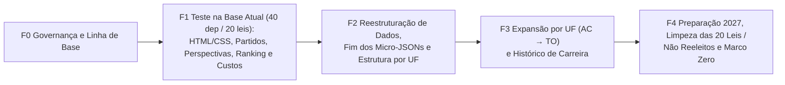

# ROADMAP.md — Fases, Etapas e Revisões

> **Como usar:** leia antes o `PROMPT_GERAL.md` e o `RELATORIO_AGENTE.md`. Execute a **primeira etapa com `[ ]`** da fase em andamento, atenda aos critérios de **Aceite**, marque `[x]` e registre no `RELATORIO_AGENTE.md`. A **última etapa de toda fase é uma Revisão** (checklist do `PROMPT_GERAL.md` §10). Não se avança de fase sem aprovação do usuário.
>
> Referências entre colchetes, como `[PE §5.1]`, apontam para seções do `PLANO_EVOLUCAO.md`.

---

## Visão geral

| Fase | Entrega | Base usada | Versão ao concluir |
| :--- | :--- | :--- | :--- |
| — | Planejamento e governança | MVP atual | `v0.1.0-plan` ✅ |
| **F0** | Fundação, governança, `README.md` nas pastas e aviso de Modo Teste | 40 dep. / 20 leis | `v0.2.0` ✅ |
| **F1** | Teste das novas visões: HTML/CSS, Visão do Partido, Perspectivas (Dono, Povo, Mercado), novo Ranking e Custos | 40 dep. / 20 leis | `v0.3.0` ✅ |
| **F2** | Reestruturação de arquivos, fim dos micro-JSONs e estrutura `parlamentares_uf/` + `cache_ceap/` | Migração estrutural | `v0.4.0` |
| **F3** | Expansão por UF (`AC` → `TO`) e auditoria em ondas regionais | 513 dep. (57ª/58ª) | `v0.5.0` |
| **F4** | Preparação final 2027: remoção das 20 leis de teste e dos não reeleitos (dos 40), Dossiê de Carreira e Reset `01/01/2027` | Oficial 58ª Legislatura | `v1.0.0` |

> **Regra de transição:** as **20 leis** e os **40 deputados** atuais continuam ativos durante toda a **Fase 1** para validar layout, perspectivas, visão partidária, ranking e custos antes de reestruturar a base. As 20 leis e os deputados (dentre os 40) que não fizerem parte da próxima legislatura só são removidos na **Fase 4** (fim da preparação para o ano que vem).

---

## Fase 0 — Fundação, Governança e Linha de Base

### Etapa 0.1 — Congelar o MVP como referência
- [x] Criar a tag Git `v0.1.0-mvp` no commit atual do MVP.
- [x] Copiar `public/ranking_final.json`, `dados/projetos.json`, `dados/deputados.json`, `dados/tetos_ceap_2026.json` e `dados/cache_bruto.json` para `tests/fixtures/legado/` como referência de conferência.
- **Aceite:** a tag existe e os arquivos de referência têm o mesmo checksum dos originais.

### Etapa 0.2 — Consolidação documental e `README.md` por pasta
- [x] Conferir se todo conteúdo útil de `plano__ranking.md`, `Regras-agentes.md`, `Relatos.md`, `MAPA_PROJETO.md` e `lista_previa.md` está coberto por `PROMPT_GERAL.md`, `PLANO_EVOLUCAO.md`, `RELATORIO_AGENTE.md` e `ROADMAP.md`.
- [x] Mover esses 5 documentos legados para `lixeira/AAAA-MM-DD/`.
- [x] Atualizar o `README.md` da raiz e criar um `README.md` curto (15 a 30 linhas) em `dados/`, `scripts/` e `public/` `[PE §1.5, §2.1]`.
- **Aceite:** raiz limpa com os 4 documentos principais + `README.md`; toda pasta existente possui seu `README.md`.

### Etapa 0.3 — Configuração do sistema e aviso de Modo Teste
- [x] Criar `dados/configuracao_sistema.json` com `"modo_operacao": "DADOS_DE_TESTE"`, ano vigente e parâmetros globais `[PE §2.1, §3.1]`.
- [x] Incluir no `metadata` de `public/ranking_final.json` os campos `"modo_operacao": "DADOS_DE_TESTE"` e `"aviso_legal"` `[PE §3.1]`.
- [x] Atualizar `.gitignore` para cobrir `.playwright-cli/` e caches temporários pesados.
- **Aceite:** `configuracao_sistema.json` criado e validado; `.gitignore` atualizado.

### Etapa 0.4 — 🔍 Revisão da Fase 0
- [x] Executar o checklist do `PROMPT_GERAL.md` §10.
- [x] Confirmar que os 40 deputados e as 20 leis seguem íntegros para os testes da Fase 1.
- [x] Atualizar a versão para `v0.2.0` no `RELATORIO_AGENTE.md` e obter aprovação do usuário para iniciar a Fase 1 (aguardando aprovação explícita do usuário para iniciar Fase 1).

---

## Fase 1 — Teste das Novas Visões na Base Atual (40 Deputados e 20 Leis)

> **Escopo desta fase:** validar toda a experiência de cálculo, perspectivas e interface **antes** de reestruturar a base de dados. Continuam em uso os **40 deputados** e as **20 leis** atuais.

### Etapa 1.1 — Novo motor de cálculo e nova análise de custos (`scripts/calcular.py`)
- [x] Implementar a nova fórmula oficial `[PE §5.1–5.3]` sobre os 40 deputados e 20 leis atuais:
  - **Nota da Perspectiva ($N_P$, peso `0,7`):** voto binário estilo prova (`1` = acertou o gabarito $G_{P,i}$; `0` = errou, ausente, abstenção ou obstrução desalinhada), média ponderada por $RP_i$ convertida para `0` a `10` (com trava `0,00` se $\sum RP_i = 0$).
  - **Nota Fixa de Custo e Conduta ($N_{CC}$, peso `0,3`):** unificada de `0` a `10`, combinando Economia de Recursos Públicos ($E_{custo}$) e Assiduidade/Conduta Disciplinar ($E_{conduta}$).
  - **Nota Final:** $NF_P = (0{,}7 \times N_P) + (0{,}3 \times N_{CC})$.
- [x] Implementar os **5 critérios oficiais de desempate** `[PE §5.4]`: (1) menor nº de faltas não justificadas → (2) menor nº de faltas totais → (3) maior nº de projetos aprovados → (4) menor custo total ao povo → (5) ordem alfabética.
- [x] Adicionar no JSON exportado os blocos para **nova análise de custos** (custo mensal médio por parlamentar, % do teto da UF e custo médio por partido) e **visão do partido** (orientação/alinhamento × voto real dos deputados do partido na amostra).
- **Aceite:** 2 deputados calculados à mão e conferidos até a 2ª casa decimal; `calcular.py` gera `public/ranking_final.json` válido.

### Etapa 1.2 — Curadoria inicial das 3 perspectivas de teste (Dono, Povo e Mercado)
- [x] Criar `dados/perspectivas/README.md` e `dados/perspectivas/INSTRUCAO_PENSAMENTO.md` com os critérios analíticos para avaliar projetos sem cair em títulos enganosos `[PE §6.2]`.
- [x] Criar `dados/perspectivas/catalogo_perspectivas.json` `[PE §6.1]` contendo, para as **20 leis atuais**, as 3 perspectivas iniciais de teste:
  1. **Visão do Dono** (`visao_dono` — migrada do gabarito antigo de `dados/projetos.json`);
  2. **Povo** (`povo` — critério voltado ao cidadão/consumidor/trabalhador);
  3. **Mercado** (`mercado` — critério voltado ao setor produtivo, ambiente de negócios e previsibilidade fiscal).
- [x] Reexecutar `scripts/calcular.py` gerando `notas_por_perspectiva` para as 3 visões em `public/ranking_final.json`.
- **Aceite:** alternar entre as 3 perspectivas produz notas e ordenações coerentes e auditáveis nas 20 leis.

### Etapa 1.3 — Mudança de HTML e CSS (`public/index.html` e `public/style.css`)
- [x] Adicionar banner visual fixo de **Dados de Teste / Calibragem** informando o início oficial em `01/01/2027` `[PE §3.1]`.
- [x] Adicionar seletor global de **Perspectiva** (Visão do Dono / Povo / Mercado / apenas Custo & Conduta) `[PE §6.1]`.
- [x] Atualizar a estrutura da **nova visão de ranking**: exibir claramente Nota da Perspectiva ($N_P$, 70%), Nota Fixa de Custo & Conduta ($N_{CC}$, 30%) e Nota Final ($NF_P$), além de filtros por Estado (UF), Partido e Projeto.
- [x] Adicionar seção/aba de **Visão do Partido** (orientação/sugestão do partido × divergência interna dos deputados, coerência e custo médio por partido) e **Nova Análise de Custos** (comparativo de gasto × teto da UF e média partidária).
- [x] Atualizar `public/style.css` mantendo HTML5/CSS3 puros (sem frameworks), tokens existentes, `:focus-visible` e responsividade mobile.
- **Aceite:** layout aprovado em desktop e mobile (`390×844`) sem overflow horizontal.

### Etapa 1.4 — Lógica da nova interface (`public/app.js`)
- [x] Implementar a troca instantânea de **Perspectiva** reordenando o ranking com os 5 critérios de desempate `[PE §5.4]`.
- [x] Renderizar a **Visão do Partido** (divergência interna, votos alinhados vs. dissidentes e custo médio por legenda) e a **Nova Análise de Custos**.
- [x] Atualizar o modal de detalhes do parlamentar exibindo o gabarito da perspectiva ativa ("Acertou" `1` / "Errou" `0`) nos 20 projetos e a decomposição $N_P$ + $N_{CC}$.
- [x] Sincronizar perspectiva, busca, UF, partido, aba ativa e ordenação via `URLSearchParams`.
- **Aceite:** todos os filtros, troca de perspectivas, aba de partido, análise de custos e modal funcionam sem erros de console.

### Etapa 1.5 — 🔍 Revisão da Fase 1
- [x] Executar o checklist do `PROMPT_GERAL.md` §10, incluindo auditoria completa via `web-design-guidelines` e `playwright-cli` (desktop e mobile `390×844`, 0 erros de console, 0 overflow).
- [x] Validar com o usuário os resultados das 3 perspectivas (Dono, Povo, Mercado), da visão de partido e da análise de custos antes de reestruturar os dados.
- [x] Atualizar a versão para `v0.3.0` no `RELATORIO_AGENTE.md` e obter aprovação do usuário para iniciar a Fase 2.

### Etapa 1.6 — Correção de Nomenclatura, Navegação e Critérios (pós-teste Fase 1)
- [x] Renomear `Visão do Dono` para **`Visão da Banca`** (`visao_banca`) no catálogo de perspectivas, no motor de cálculo e na interface, definindo-a como perspectiva principal padrão ao entrar no site.
- [x] Remover todas as referências públicas a "prova", "acertos na prova" e "gabarito" do site (mantendo apenas o conceito referencial no cálculo interno), usando linguagem de alinhamento/critério da perspectiva.
- [x] Separar a **Visão do Partido** em uma página própria (`public/partidos.html`) acessível por navegação no topo do site (`Ranking` / `Partidos`).
- [x] Mover o seletor de **Visão do Ranking (Perspectiva)** do topo para a barra de filtros no lugar de `Projeto (Filtro por lei)`, acompanhado de um **botão em formato de olho** que abre os critérios da nota e os votos esperados da visão selecionada.
- **Aceite:** navegação entre `index.html` e `partidos.html` funcionando, `Visão da Banca` como padrão, botão de olho exibindo critérios e votos esperados, zero menções a "prova/acertos" no site e auditoria Playwright sem erros.

---

## Fase 2 — Reestruturação de Dados, Fim dos Micro-JSONs e Estrutura por UF

### Etapa 2.1 — Eliminação dos micro-arquivos JSON (`dados/_tmp/`)
- [ ] Conferir se todos os metadados úteis de `dados/_tmp/prop_*.json` (22) e `dados/_tmp/vot_*.json` (21) estão consolidados no arquivo único `dados/projetos.json` e em `dados/cache_votacoes.json` `[PE §1.1, §2.1]`.
- [ ] Mover `dados/_tmp/`, `dados/_*.json` e `dados/_lookup_votacoes.txt` para `lixeira/AAAA-MM-DD/`.
- **Aceite:** zero arquivos `prop_*.json` ou `vot_*.json` soltos em `dados/`; `projetos.json` e `cache_votacoes.json` são os únicos arquivos de proposições e votações.

### Etapa 2.2 — Nova estrutura de pastas por UF e histórico
- [ ] Renomear/migrar `dados/tetos_ceap_2026.json` → `dados/tetos_ceap.json` (movendo o antigo para `lixeira/`).
- [ ] Criar `dados/parlamentares_uf/` (com `README.md`), `dados/cache_ceap/` (com `README.md`, ignorado no Git se ultrapassar limite) e `dados/historico_carreira/` (com `README.md`) `[PE §1.1, §2.1]`.
- [ ] Migrar os 40 deputados atuais para `dados/parlamentares_uf/[UF].json` conforme suas respectivas UFs sem perder dados.
- **Aceite:** toda nova pasta possui `README.md`; `calcular.py` lê a nova estrutura mantendo os mesmos resultados da Fase 1.

### Etapa 2.3 — Scripts por UF e auditoria automatizada (`scripts/coletar.py` e `scripts/auditar_uf.py`)
- [ ] Atualizar `scripts/coletar.py` para aceitar `--uf SIGLA` (e modo lote quando indicado), gravando votações em `dados/cache_votacoes.json` e despesas CEAP por estado em `dados/cache_ceap/[UF].json` `[PE §1.1, §1.4]`.
- [ ] Criar `scripts/auditar_uf.py --uf SIGLA` validando: nº exato de cadeiras da UF, ausência de `null` em ID/nome/partido/foto/despesas e consistência da CEAP com o teto da UF `[PE §4]`.
- [ ] Criar testes unitários (`unittest`) cobrindo a fórmula `N_P` / `N_CC`, os 5 critérios de desempate e a auditoria por UF.
- **Aceite:** `python scripts/coletar.py --uf GO` e `python scripts/auditar_uf.py --uf GO` executam com sucesso; `python -m unittest` passa.

### Etapa 2.4 — 🔍 Revisão da Fase 2
- [ ] Executar o checklist do `PROMPT_GERAL.md` §10.
- [ ] Confirmar que `dados/deputados.json` antigo foi movido para `lixeira/` após validação completa da migração por UF.
- [ ] Atualizar a versão para `v0.4.0` no `RELATORIO_AGENTE.md` e obter aprovação do usuário para iniciar a Fase 3.

---

## Fase 3 — Expansão por UF (`AC` → `TO`) e Histórico de Carreira

### Etapa 3.1 — Carga e auditoria por UF — Onda 1 (`AC` a `ES`)
- [ ] Executar o ciclo de 3 passos (`coletar.py --uf` → `auditar_uf.py --uf` → correção manual e registro em `RELATORIO_AGENTE.md`) `[PE §4]` para: `AC`, `AL`, `AM`, `AP`, `BA`, `CE`, `DF`, `ES`.
- **Aceite:** 8/8 UFs aprovadas em `auditar_uf.py`.

### Etapa 3.2 — Carga e auditoria por UF — Onda 2 (`GO` a `PE`)
- [ ] Executar o ciclo de 3 passos para: `GO`, `MA`, `MG`, `MS`, `MT`, `PA`, `PB`, `PE`.
- **Aceite:** 16/27 UFs aprovadas em `auditar_uf.py`.

### Etapa 3.3 — Carga e auditoria por UF — Onda 3 (`PI` a `TO`)
- [ ] Executar o ciclo de 3 passos para: `PI`, `PR`, `RJ`, `RN`, `RO`, `RR`, `RS`, `SC`, `SE`, `SP`, `TO`.
- **Aceite:** 27/27 UFs (513 deputados) aprovadas em `auditar_uf.py` e consolidadas no ranking.

### Etapa 3.4 — Coleta de votações nominais e orientações partidárias em escala
- [ ] Expandir `scripts/coletar.py` para coletar automaticamente votações nominais do plenário e orientações oficiais das bancadas para `dados/cache_votacoes.json`.
- [ ] Garantir que a **Visão do Partido** e a **Análise de Custos** funcionem com todos os 513 deputados sem queda de fluidez no navegador (paginação/renderização eficiente em `public/app.js`).
- **Aceite:** ranking completo com 513 deputados validado via `playwright-cli` em desktop e mobile.

### Etapa 3.5 — 🔍 Revisão da Fase 3
- [ ] Executar o checklist do `PROMPT_GERAL.md` §10, incluindo conferência manual de amostra aleatória de 10 deputados em UFs distintas.
- [ ] Atualizar a versão para `v0.5.0` no `RELATORIO_AGENTE.md` e obter aprovação do usuário para iniciar a Fase 4.

---

## Fase 4 — Preparação Final 2027, Limpeza das 20 Leis / Não Reeleitos e Marco Zero

> **Objetivo desta fase:** preparar a transição definitiva para o ano que vem, realizando a limpeza dos dados de teste (as 20 leis e os deputados dos 40 iniciais que não assumirão a próxima legislatura) e ativando o Dossiê de Histórico de Carreira para os assumintes de 2027.

### Etapa 4.1 — Remoção dos deputados não reeleitos (dentre os 40) e atualização da 58ª Legislatura
- [ ] Atualizar `dados/parlamentares_uf/[UF].json` (`AC` → `TO`) com a lista oficial dos parlamentares da **58ª Legislatura**.
- [ ] **Remover do ranking ativo os deputados (incluindo os dos 40 iniciais) que não fizerem parte da próxima legislatura**, arquivando o snapshot legado em `lixeira/` para histórico `[PE §3.2]`.
- [ ] Reexecutar `scripts/auditar_uf.py` para as 27 UFs confirmando a composição oficial da nova legislatura.
- **Aceite:** apenas parlamentares da próxima legislatura permanecem ativos nas 27 UFs.

### Etapa 4.2 — Dossiê de Histórico de Carreira (Exclusivo para assumintes em 2027)
- [ ] Implementar coleta via `scripts/coletar.py --historico` gravando `dados/historico_carreira/historico_geral.json` `[PE §1.3, §3.3]`: grau de experiência (novato vs. reeleito e legislaturas anteriores), histórico financeiro acumulado por ano (CEAP + Gabinete) e resumo de carreira (partidos, cargos, projetos aprovados).
- [ ] Adicionar a aba **"Dossiê de Carreira (Mandatos Anteriores)"** dentro do Modal de Auditoria do Parlamentar em `public/`, garantindo que gastos passados **nunca** contaminem a nota ativa ($N_{CC}$) de 2027.
- **Aceite:** modal exibe o dossiê histórico para reeleitos e indica "1º mandato" para novatos, com $N_{CC}$ isolada no mandato vigente.

### Etapa 4.3 — Curadoria definitiva de perspectivas e remoção das 20 leis de teste
- [ ] Revisar e consolidar `dados/perspectivas/INSTRUCAO_PENSAMENTO.md` com as regras definitivas de curadoria para as perspectivas de produção `[PE §6.2]`.
- [ ] **Remover as 20 leis de teste** usadas na homologação (arquivando o catálogo de teste em `lixeira/`), zerando `dados/projetos.json` e os gabaritos de `dados/perspectivas/catalogo_perspectivas.json` para as votações da nova legislatura.
- **Aceite:** nenhuma lei de teste permanece no catálogo ativo; `INSTRUCAO_PENSAMENTO.md` aprovado pelo usuário.

### Etapa 4.4 — Marco Zero (`01/01/2027`) e Posse (`01/02/2027`)
- [ ] Virar `dados/configuracao_sistema.json` para `"modo_operacao": "OFICIAL_58_LEGISLATURA"` e atualizar o banner da interface `[PE §1.2, §3.2]`.
- [ ] Zerar todas as variáveis ativas (votos, faltas e gastos de 2027), garantindo que o site exiba `"Aguardando início das votações da 58ª Legislatura"` sem divisão por zero e ordenação determinística pelo 5º critério de desempate `[PE §1.7, §5.1]`.
- **Aceite:** `calcular.py` gera ranking zerado válido e `public/` renderiza corretamente sem erros de console.

### Etapa 4.5 — 🔍 Revisão Final da Fase 4 (Go-live `v1.0.0`)
- [ ] Executar o checklist completo do `PROMPT_GERAL.md` §10.
- [ ] Rodar auditoria final com `web-design-guidelines`, `playwright-cli` e `python -m unittest`.
- [ ] Atualizar a versão para `v1.0.0` no `RELATORIO_AGENTE.md` com aprovação do usuário e publicar na Vercel.
